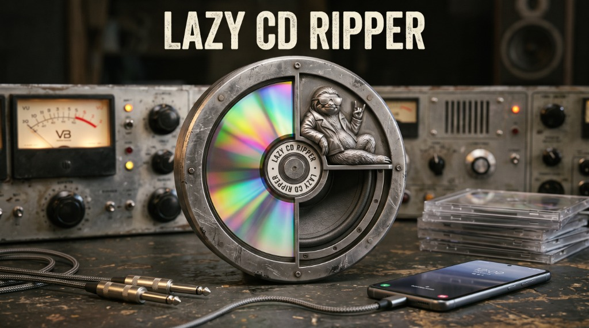
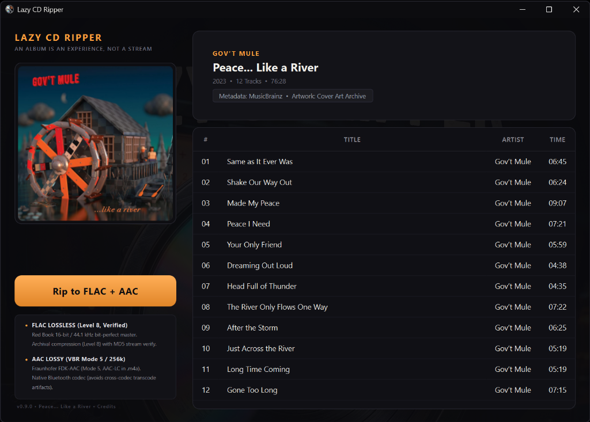

<p align="center">
  
</p>

# Lazy CD Ripper 💿

**The audio CD ripper with zero settings (Windows only).**  
The whole point of being "lazy": you shouldn't have to fiddle with menus, calibrate drive read offsets, configure buffer sizes, or agonize between lossy and lossless formats. The best defaults are already baked in. Insert a disc, click one button, and get the job done right.

> **Platform Note:** Lazy CD Ripper is built specifically for **Windows 10 and 11** (utilizing direct Win32 hardware I/O for raw Red Book CDDA sector reading). macOS and Linux are not supported.

<p align="center">
  
</p>

---

## Download & Getting Started

### 📦 Standalone Portable Zip (Recommended)
Download the latest portable release archive from **[GitHub Releases](https://github.com/lazyhead-code/lazycdripper/releases)**.
- Standalone `.zip` with pre-bundled `ffmpeg.exe` and Python runtime.
- Zero installation or system dependencies required. Extract the zip anywhere and run `LazyCDRipper.exe`.

### 🐍 Run from Source (Development)
Requirements: Windows 10 or 11 (64-bit), Python 3.10+, and an optical CD drive.
```bash
git clone https://github.com/lazyhead-code/lazycdripper.git
cd lazycdripper

python -m venv .venv
.venv\Scripts\activate
pip install -e ".[dev]"

# Launch
lazycdripper

# Run tests
python -m unittest discover -s tests -v
```

---

## Why This Exists

> We've gained so much with music streaming services.  
> We've lost so much as well.  
> 
> Buying a music CD and listening to the whole album brings back the magic.  
> 
> We don't have CD drives in cars and laptops anymore. But we can rip music for ourselves (all it takes is an external drive), copy it to our phone, and have the exact same experience.  
> 
> This application is opinionated AF, but it rips to virtually the best options: high-quality AAC and FLAC. Why AAC instead of MP3? Because modern Bluetooth headphones use AAC natively; using a lossy codec from a different family is not optimal. Why FLAC? Because it's a picture-perfect copy of your CD—highest possible quality. We may not really hear the difference much, but I'm glad to surrender to an illusion :)  
> 
> Have fun and welcome back to the magical world of music!  
> 
> Yours truly,  
> **Lazyhead Code 💿**

---

## The Philosophy: Zero Settings, Best Defaults

Most CD rippers force you through dozens of technical decisions before ripping a single song. Lazy CD Ripper has **no settings panel by design**:

- **1-Button Flow:** Insert an audio CD, click **Rip to FLAC + AAC**, and choose where to save the album. That's it.
- **Both Formats in One Pass:** Never choose between archival quality and mobile convenience. You always get both:
  - **FLAC (Level 8):** Bit-perfect Red Book (16-bit / 44.1 kHz) lossless master.
  - **AAC (256k VBR):** Ready for phones and Bluetooth headphones (native AAC-LC playback avoids lossy cross-codec re-compression).
- **Automatic Metadata & High-Res Artwork:** MusicBrainz disc ID lookup + canonical front covers from the Cover Art Archive embedded in every track, plus a companion `cover.jpg` for media servers.
- **Sensible Organization:** Clean, zero-padded filenames in dedicated folders (`Artist - Album (Year) [FLAC]/` and `[AAC]/`).

---

## Features

- **Direct Win32 CDDA Extraction:** Reads raw 2,352-byte Red Book sectors via Windows `DeviceIoControl` with hardware retry fallbacks. No ASPI drivers or Cygwin required.
- **Pure-Python DiscID:** Calculates MusicBrainz disc IDs natively without external C `libdiscid` dependencies.
- **Self-Contained:** Bundled `ffmpeg.exe` for encoding; no system codec configuration needed.
- **Tagging & Art Embedding:** Complete Vorbis comments, MP4 atoms, and embedded cover art via `mutagen`.
- **Tactile Dark UI:** Clean PySide6 desktop interface designed for clarity and speed.

---

## Directory Structure

Ripped albums are neatly organized into separate FLAC and AAC folders:

```text
Music/
├── Gov't Mule - Peace... Like a River (2023) [FLAC]/
│   ├── 01 - Same as It Ever Was.flac
│   ├── 02 - Shake Our Way Out.flac
│   ├── ...
│   └── cover.jpg
└── Gov't Mule - Peace... Like a River (2023) [AAC]/
    ├── 01 - Same as It Ever Was.m4a
    ├── 02 - Shake Our Way Out.m4a
    ├── ...
    └── cover.jpg
```

---

## Release Notes

### v0.9.0 — *"Peace... Like a River"* (October 2026)
> *This is the initial release of Lazy CD Ripper. Opinionated AF way to extract music from your CDs. Zero choices to make because the defaults are great! It works, I've tested it on quite a bunch of my music discs already. I will use it for some more time (and will share with friends) before releasing 1.0. Some minor polishing is likely to be done.*

---

## Architecture Overview

1. **Hardware & TOC:** Direct Win32 `IOCTL_CDROM_READ_TOC` and SCSI storage property queries.
2. **Ripper Engine:** Native Win32 sector-by-sector CDDA extraction with hardware buffer alignment, gap padding, and retry recovery (`windows.py`).
3. **Metadata Client:** MusicBrainz WS2 JSON API + Cover Art Archive image ranking.
4. **Encoding Pipeline:** Parallel lossless FLAC and Fraunhofer FDK-AAC encoding via FFmpeg.
5. **Tagging:** Mutagen handles Vorbis comment blocks and MP4 atoms with high-res cover art embedding.

---

## Acknowledgments & Credits

Lazy CD Ripper is proudly built on open-source technologies:
- **FFmpeg** — Audio encoding engine (FLAC & AAC)
- **Mutagen** — Audio metadata tagger & cover art embedder
- **Qt 6 / PySide6** — Hi-DPI desktop GUI framework
- **MusicBrainz WS2** — Global acoustic CD metadata discovery via `musicbrainzngs`
- **Pillow** — Digital cover art optimization

Crafted in pair programming with **Antigravity** (Google DeepMind).

For detailed third-party software licenses and source links, see [THIRD_PARTY_LICENSES.md](THIRD_PARTY_LICENSES.md).

---

## License

GNU General Public License v3.0 (GPLv3). Copyright (c) 2026 Lazyhead Code <lazyhead@fastmail.com>.  
See [LICENSE](LICENSE) for full project license terms.
